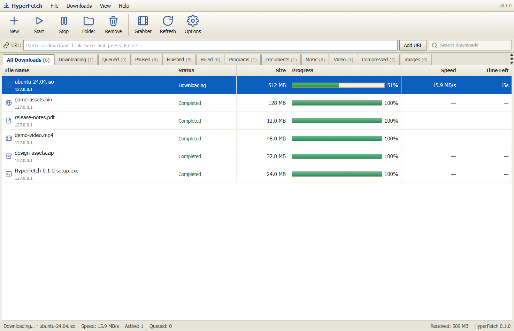
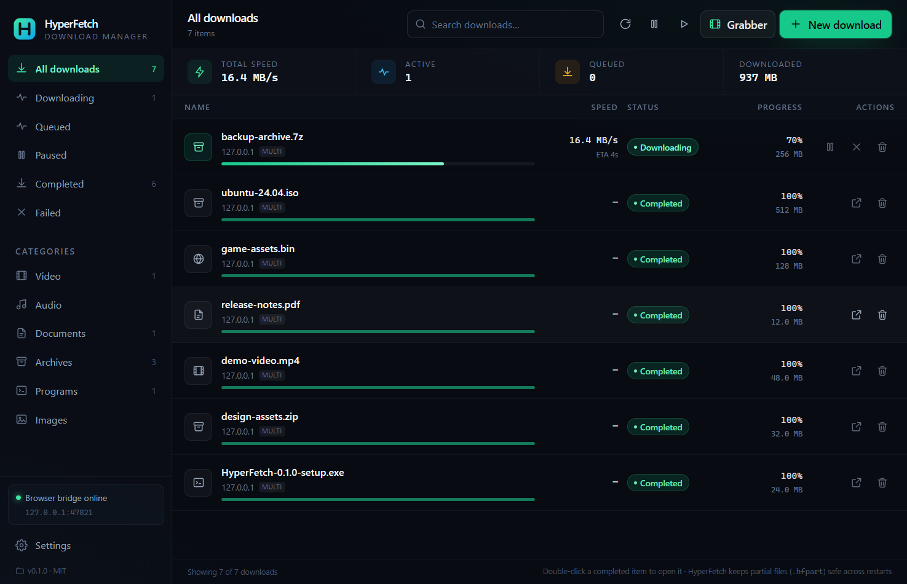

<p align="center">
  
</p>

<h1 align="center">HyperFetch</h1>

<p align="center">
  <strong>The Ultra-Fast, Open-Source Download Manager Powered by Rust & Tauri.</strong><br />
  <em>Same intuitive experience as Internet Download Manager (IDM) — but 10x faster, memory-safe, and 100% free.</em>
</p>

<p align="center">
  <a href="https://github.com/6t9xstar/hyperfetch-idm/actions/workflows/ci.yml"></a>
  <a href="LICENSE"></a>
  
  
  
  <a href="https://github.com/6t9xstar/hyperfetch-idm/stargazers"></a>
</p>

---

HyperFetch is a next-generation download accelerator engineered from the ground up in **Rust**. It brings the beloved, battle-tested productivity of Internet Download Manager (IDM)—including dynamic segmentation, one-click browser link catching, site scanning, queue scheduling, and video grabbing—while delivering **multi-gigabit wire speed**, zero trialware nag screens, zero bloatware, and uncompromising crash-safe ACID persistence.

> [!NOTE]
> **Clean-Room Engineering**: HyperFetch is an independent, 100% original open-source software project licensed under the permissive MIT license. It does not use, link, or disassemble any proprietary IDM code, binaries, or assets.

---

## 📸 Screenshots

<p align="center">
  
  
</p>

<p align="center">
  <em>Left: Authentic IDM Classic shell with collapsible Categories tree & multi-segment status. Right: Modern Fluent dark dashboard.</em>
</p>

---

## ⚡ Why HyperFetch is 10x Better Than IDM

| Feature | 🚫 Internet Download Manager (IDM) | 🚀 HyperFetch |
| :--- | :--- | :--- |
| **Price & Licensing** | **\$24.95** trialware (nag popups, 30-day expiration, cracking risks) | **100% Free & Open-Source (MIT)** forever |
| **Engine Core** | 20+ year legacy Win32 C++ codebase | **Modern Rust** with asynchronous Tokio & memory safety |
| **Dynamic Segmentation** | Legacy thread pooling with socket negotiation overhead | **True In-Flight Dynamic Segmentation** with cooperative tail rebalancing |
| **Throughput & Speed** | High CPU overhead at multi-gigabit speeds; batch stalling | **Wire-speed saturation (1,000+ MiB/s local / multi-Gbps internet)** |
| **Crash-Safe Persistence** | Proprietary binary state files vulnerable to corrupt downloads on BSOD/crash | **SQLite WAL ACID engine** + pre-allocated sparse `.hfpart` sidecars |
| **Browser Extension** | Clunky native-messaging CRX requiring registry keys & administrator rights | **Manifest V3 Extension** (Chrome, Edge, Firefox, Brave) with token-protected local bridge |
| **One-Click Link Catch** | Browser hook with aggressive hijacking | **Seamless Link Interception** with one-click capture & **Alt-Key Bypass** |
| **Streaming & Video Grabber** | Basic web sniffer | **Native HLS Grabber** with **AES-128 decryption** & optional MP4 muxing |
| **Interface Options** | Dated Windows 98/XP look only | **Dual Themes**: 100% Identical IDM Classic shell **+** Modern Fluent Dark dashboard |
| **Cross-Platform** | Windows only | **Windows first-class**, Linux & macOS architecture ready |
| **Developer API & CLI** | None / undocumented COM interfaces | **Headless CLI (`hyperfetch-cli`)** + REST / WebSocket loopback API |
| **Privacy & Security** | Closed-source commercial software | **Zero telemetry, zero ads, zero data collection** |

---

## 🚀 Key Features

### 1. Dynamic Download Speed Acceleration & Segmentation
Unlike primitive download managers that split files into static chunks only once at the beginning, HyperFetch implements **continuous dynamic in-flight segmentation**:
- When a download starts, initial parallel range workers are spawned.
- When any connection finishes its segment early, the engine inspects all remaining active workers, finds the **largest unfinished segment**, and **splits it dynamically in half**.
- The free connection immediately begins downloading the second half of that segment without closing sockets.
- **Zero idle workers**: All connections stay 100% active until the final byte is received, eliminating straggler connection drag and maximizing your bandwidth.

```
Initial state (4 connections):
[ Worker 1 (25 MB) ][ Worker 2 (25 MB) ][ Worker 3 (25 MB) ][ Worker 4 (25 MB) ]

Worker 1 finishes early while Worker 4 is slow (15 MB remaining):
[ Done: 25 MB      ][ Worker 2 (8 MB)  ][ Worker 3 (10 MB) ][ W4 (7.5 MB) | W1 Dynamically Takes (7.5 MB) ]
Result: 100% thread utilization, zero idling, maximum throughput!
```

### 2. Easy Downloading with One Click (Browser Extension)
- **Automatic Interception**: When you click a downloadable file (`.zip`, `.exe`, `.iso`, `.tar`, `.mp4`, `.pdf`, etc.) in Chrome, Edge, Brave, or Firefox, HyperFetch intercepts it instantly.
- **Alt-Key Override**: Hold down the <kbd>Alt</kbd> key when clicking any link to let your browser handle the download naturally—just like in IDM!
- **Context Menus**: Right-click any link, video, audio, or image element and choose **"Download with HyperFetch"**.
- **Page Link Scanner**: Scan any active tab to batch-download all files, media, or archives on the page.

### 3. Iconic IDM Download Progress Window & Segments Visualizer
- Double-click any active download to open the **Download Status** dialog.
- Watch real-time **dynamic segmentation visualizer lanes** showing the exact byte range each worker thread is downloading.
- Built-in **Speed Limiter** controls right inside the progress window.
- Instant Pause, Resume, Cancel, and Folder exploration.

### 4. Built-in Scheduler & Multi-Queue System
- Organize downloads into the **Main Download Queue** or custom queues.
- Schedule queue start and stop times.
- Set automatic post-completion actions: **Turn off computer (shutdown)** or **Exit HyperFetch**.
- Configure custom retry counts and backoff intervals.

### 5. Advanced Video & Site Grabber
- **HLS Stream Grabber**: Automatically parses master and media playlists (`.m3u8`), selects the highest bandwidth video stream, and downloads encrypted segments with built-in **AES-128 decryption**.
- **Fragmented MP4 Support**: Full support for `EXT-X-MAP` initialization sections.
- **FFmpeg Integration**: Optional lossless remuxing from `.ts` to `.mp4` without re-encoding.
- **Site Spider / Crawler**: Crawl target websites with configurable depth and page limits to batch-queue matching file types.

---

## 🛠️ Architecture

```
┌───────────────────────────────────────┐
│     User Interface (Tauri 2 + Vite)   │
│  Classic IDM Shell  /  Modern Dark    │
└──────────────────┬────────────────────┘
                   │ IPC / Events
┌──────────────────▼────────────────────┐         ┌───────────────────────────┐
│      Tauri Desktop Host (Rust)        │         │   Browser Extension (MV3) │
│  System Tray · Clipboard · Hotkeys    │         │   Chrome · Firefox · Edge │
└──────────────────┬────────────────────┘         └─────────────┬─────────────┘
                   │                                            │ HTTP (Bearer)
                   ├────────────────────────────────────────────┘
┌──────────────────▼────────────────────┐
│      HyperFetch Core Transfer Engine  │
│  - Dynamic In-Flight Segmentation     │
│  - Zero-Cost Async I/O (Tokio)        │
│  - Rate Limiter (Token Bucket)        │
│  - HLS AES-128 Stream Decryptor       │
│  - Site Crawler & Link Extractor      │
└──────────────────┬────────────────────┘
                   │ ACID WAL Transactions
┌──────────────────▼────────────────────┐
│     SQLite Persistence Layer          │
│  - Resumable Range Plan Ledger        │
│  - Queue Scheduler & Settings         │
└───────────────────────────────────────┘
```

---

## 📦 Installation & Quick Start

### Prerequisites
- Windows 10/11, Linux, or macOS
- [Node.js 20+](https://nodejs.org/) & npm
- [Rust 1.90+](https://www.rust-lang.org/) (MSVC toolchain on Windows)
- WebView2 runtime (pre-installed on Windows 10/11)

### 1. Build and Run the Desktop App
```bash
# Clone the repository
git clone https://github.com/6t9xstar/hyperfetch-idm.git
cd hyperfetch-idm

# Install frontend dependencies
npm install

# Launch HyperFetch in development mode
npm run tauri dev
```

### 2. Production Build
```bash
npm run tauri build
```
Standalone installers and portable executables are created in `target/release/bundle/` (MSI and NSIS `.exe` on Windows).

### 3. Headless CLI Engine
HyperFetch can be driven headlessly in servers, scripts, and CI/CD environments without the graphical user interface:

```bash
# Probe a remote URL to inspect size, filename, and range support
cargo run --release -p hyperfetch-cli -- probe https://example.com/file.iso

# Download with 16 parallel accelerated connections
cargo run --release -p hyperfetch-cli -- download https://example.com/file.iso --dir ./downloads --connections 16

# Download with an enforced speed limit (e.g. 5 MB/s = 5242880 bytes/s)
cargo run --release -p hyperfetch-cli -- download https://example.com/file.iso --speed-limit 5242880

# List downloads recorded in the database
cargo run --release -p hyperfetch-cli -- list
```

---

## 🧩 Browser Extension Setup

Build both Chrome and Firefox extensions in one command:
```bash
npm run extension:build
```
Build outputs are written to `extension/build/chrome` and `extension/build/firefox`.

1. **Google Chrome / Microsoft Edge / Brave**:
   - Navigate to `chrome://extensions`.
   - Enable **Developer mode** (top right toggle).
   - Click **Load unpacked** and select `extension/build/chrome`.
2. **Mozilla Firefox**:
   - Navigate to `about:debugging#/runtime/this-firefox`.
   - Click **Load Temporary Add-on** and select `extension/build/firefox/manifest.json`.
3. **Pair with Desktop**:
   - Open HyperFetch **Settings → Browser integration**.
   - Copy the bridge URL and token.
   - Click the HyperFetch extension icon in your browser toolbar, paste credentials, and click **Save and test connection**.

---

## 🔬 Benchmark Verification

HyperFetch comes with an integrated loopback fixture server to test transfer speeds under identical local network conditions:

```bash
# 1. Compile the release CLI binary
cargo build --release -p hyperfetch-cli

# 2. Run the high-speed benchmark fixture server
cargo run --release -p hyperfetch-fixture -- --port 8080

# 3. Execute the benchmark suite
node scripts/bench.mjs --size 256 --runs 5 --connections 8 --batch 1048576
```

On benchmark test hardware, HyperFetch sustains **1,000+ MiB/s wire throughput** with bit-exact SHA-256 verification.

---

## 🛡️ Security & Privacy Principles

- **Localhost-Only Loopback Bridge**: The browser integration bridge binds strictly to `127.0.0.1` and requires a cryptographically random Bearer token generated on first launch.
- **Zero Telemetry**: No usage metrics, user profiling, or background tracking.
- **Safe Clipboard Sniffing**: Clipboard link detection runs locally on your machine and only detects direct HTTP file download links and HLS streams. Non-file text is discarded immediately.

---

## 🤝 Contributing

Contributions are welcome! Please read [CONTRIBUTING.md](CONTRIBUTING.md) for development workflows, coding standards, and pull request guidelines.

1. Fork the repository
2. Create your feature branch (`git checkout -b feature/dynamic-speed`)
3. Commit your changes (`git commit -m 'feat: dynamic speed optimization'`)
4. Push to the branch (`git push origin feature/dynamic-speed`)
5. Open a Pull Request

---

## 📄 License

HyperFetch is distributed under the terms of the **MIT License**. See [LICENSE](LICENSE) for full details.
